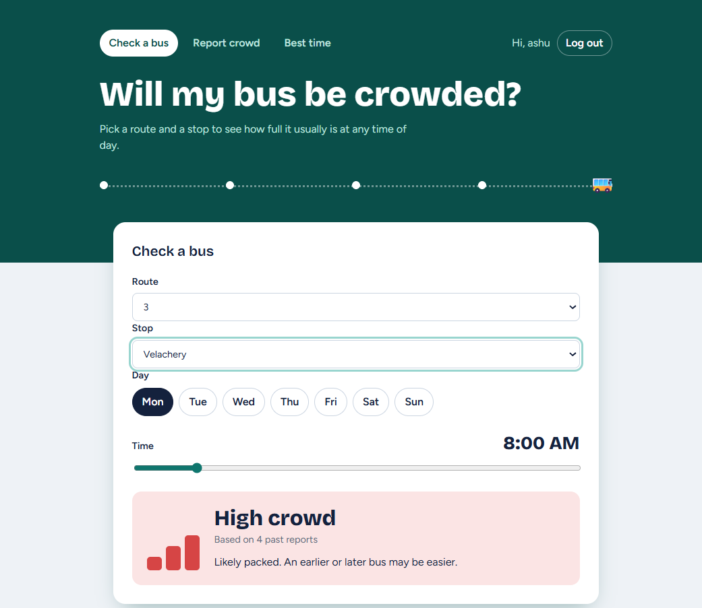
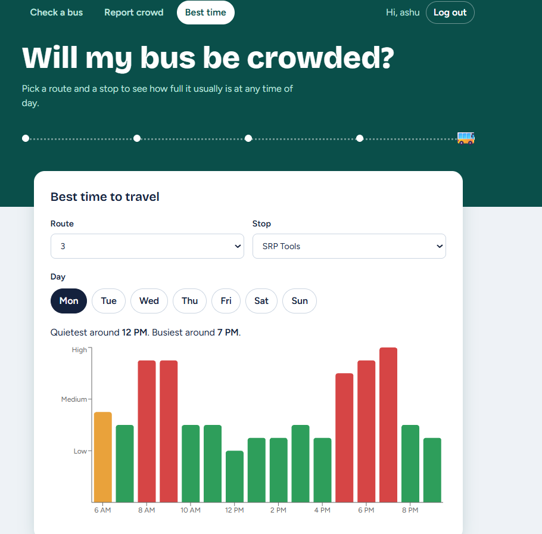
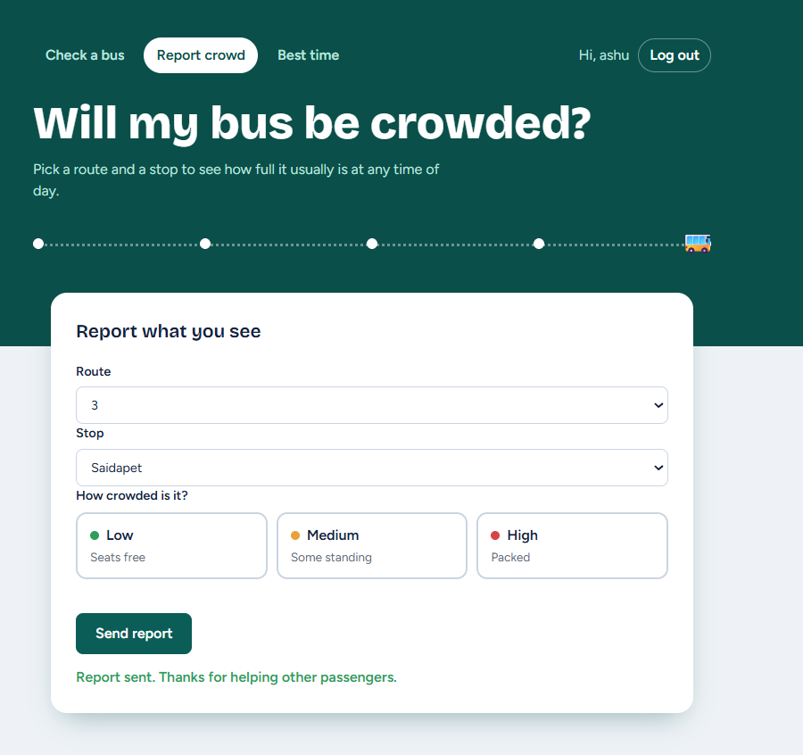

# 🚌 Bus Crowd Predictor

---

## 📌 Project Overview

This project is a **full-stack web application** that predicts how crowded a bus is likely to be. Users pick a **route, stop, day and time**, and the app shows whether the bus is usually **Low, Medium or High** crowded, based on past crowd reports. The goal is to help passengers choose a better time to travel.

---

## ⚙️ Tech Stack

- **React** → Builds the pages and handles clicks and dropdowns
- **React Router** → Moves between pages (Check a bus, Report crowd, Best time, Login)
- **Recharts** → Draws the bar chart of crowd levels by hour
- **Python + Django** → Backend that holds the data and logic
- **Django REST Framework** → Builds the API that React talks to
- **SQLite** → Database for routes, stops and crowd reports
- **Token authentication** → Login system for users

---

## ✨ Features

- **Check a bus** → Shows the expected crowd for a route, stop, day and time, and how many past reports it is based on
- **Best time to travel** → Bar chart of the average crowd at every hour, with the quietest and busiest times
- **Report crowd** → Logged-in users report how crowded a bus is
- **Login and sign up** → Only logged-in users can send reports
- **Spam limit** → One report per user, route and stop every 30 minutes
- **Smart dropdowns** → Only the stops on the chosen route are shown

---

## 📸 Screenshots

### Check a bus


### Best time to travel


### Report crowd


---

## 🧠 How the Prediction Works

The app does **not** use machine learning. It looks at past reports:

1. It finds all past reports for the same **route, stop, weekday and hour**.
2. It counts how many were Low, Medium and High.
3. The level with the **most reports** becomes the prediction.

**Example:** if a bus at a stop on Monday at 8 AM had 3 High reports and 1 Medium report in the past, the prediction is **High**.

If there are no past reports, the app says "not enough data" instead of guessing.

---

## 🗂️ Database Tables

The database has four tables:

| Table | What it stores |
|---|---|
| `Route` | Bus routes (route number and name) |
| `Stop` | Bus stops (name) |
| `RouteStop` | Which stops each route visits, and in what order |
| `CrowdReport` | Each report: route, stop, crowd level (1 = Low, 2 = Medium, 3 = High), time, and the user who sent it |

---

## ⚠️ Note About the Data

The crowd data in this demo is **simulated**. I wrote a script (`generate_reports`) that creates four weeks of sample reports, with busier weekday rush hours, so there is history to predict from. The routes and stops are sample data, not real timetables. The app is designed to work with real reports when real users submit them.

---

## 📁 Project Structure

```
bus-crowd-predictor/
├── frontend/                  → React app
│   └── src/
│       ├── App.jsx            → Navigation and page routing
│       ├── PredictForm.jsx    → Check a bus page
│       ├── SubmitForm.jsx     → Report crowd page
│       ├── Insights.jsx       → Best time chart page
│       ├── Login.jsx          → Login and sign up page
│       ├── useRouteStops.jsx  → Loads the stops of a chosen route
│       └── config.js          → Backend address
└── projectpy/                 → Django backend
    ├── predict/
    │   ├── models.py          → Database tables
    │   ├── views.py           → API logic (prediction, reports, login)
    │   ├── serializers.py     → Converts data to JSON
    │   └── management/commands/generate_reports.py  → Creates sample data
    └── requirements.txt       → Python packages
```

---

## ▶️ How to Run

**Backend**

```
cd projectpy
pip install -r requirements.txt
python manage.py migrate
python manage.py createsuperuser
python manage.py runserver
```

Open `http://127.0.0.1:8000/admin`, log in, and add some routes, stops and route stops. Then create the sample reports:

```
python manage.py generate_reports
```

**Frontend** (in a second terminal)

```
cd frontend
npm install
npm run dev
```

Open the address that `npm run dev` prints (usually `http://localhost:5173`).

---

## 🔮 Future Improvements

- Add a machine learning model and compare it with this simple method
- Deploy the app online
- Find better ways to check that a report comes from someone really on the bus

---
